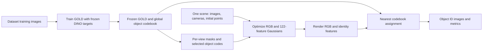

# SA-OCL

Implementation of **Scene-Agnostic Object-Centric Representation Learning for 3D Gaussian Splatting**, by Tsuheng Hsu, Guiyu Liu, Juho Kannala, and Janne Heikkilä. Reference: [arXiv:2604.09045v1](https://arxiv.org/abs/2604.09045v1). The project combines a dataset-wide GOLD object codebook with per-scene 3D Gaussian optimization and object segmentation.

This guide describes the **current code and launchers**. RGB images, ground-truth masks, some camera inputs, and trained GOLD checkpoints were removed from this workspace; restore those inputs before training. The retained DINO, DEVA, SAM, and SAM2 weights are foundation-model assets, not trained GOLD checkpoints.

This is the project's only README. All retained source is under this project root, without symbolic links or duplicate GOLD directories. `original` identifies inherited Gaussian Grouping code, including pre-existing local changes; `paper` identifies our implementations and adaptations for the paper; `baselines` contains comparison implementations.

## Contents

- [How the project works](#how-the-project-works)
- [Directory and entrypoint map](#directory-and-entrypoint-map)
- [Environment setup](#environment-setup)
- [Build the CUDA rasterizers](#build-the-cuda-rasterizers)
- [Models and checkpoints](#models-and-checkpoints)
- [Data setup](#data-setup)
- [Preprocessing](#preprocessing)
- [Train GOLD](#train-gold)
- [Run the combined training and evaluation jobs](#run-the-combined-training-and-evaluation-jobs)
- [Run one scene manually](#run-one-scene-manually)
- [Outputs and metrics](#outputs-and-metrics)
- [Baselines and other components](#baselines-and-other-components)
- [Experiment settings and paper differences](#experiment-settings-and-paper-differences)
- [Troubleshooting](#troubleshooting)
- [References and provenance](#references-and-provenance)

## How the project works

There are two training stages. **GOLD learns across scenes**, then its checkpoint is frozen while **each Gaussian scene is optimized separately**. The combined metric launchers perform the second stage, rendering, and evaluation; GOLD training happens beforehand.



1. **Learn global object identities.** [GOLD_Code/train_ocl.py](GOLD_Code/train_ocl.py) trains `GOLD_Code.ocl_origin.OCL`. Slots select learnable object prototypes and combine intrinsic identity features with extrinsic features. Frozen DINO ViT-B/8 provides feature-reconstruction targets. In the active branch called `octa`, RGB CNN features supply the attention input. Training includes reconstruction, variational KL terms, and background regularization.
2. **Optimize a Gaussian scene.** The paper trainers freeze GOLD, derive masks and selected codes for each training view, and build a dense identity-feature target. Each Gaussian stores geometry, opacity, RGB spherical harmonics, and a 122-dimensional identity vector. RGB L1/SSIM and feature MSE supervise the scene. `--regloss3d` adds neighborhood identity consistency through KL divergence; densification and pruning remain part of optimization.
3. **Render and identify objects.** The renderer alpha-blends identity vectors with the same visibility used for RGB. Each pixel is assigned to the nearest global prototype by squared L2 distance, with a zero-vector background entry. Slot order therefore does not define output identity.
4. **Evaluate saved views.** The evaluator compares rendered ID masks and RGB images with ground truth, writes per-scene scores, and optionally retains the complete scene output.

The standard paper configuration has 8 slots including background, 11 foreground prototypes, a 128-dimensional foreground slot split into **122 intrinsic + 6 extrinsic** dimensions, and an 8-dimensional background representation. Prototype numbers belong to one checkpoint's vocabulary; independently trained OCTA and GSO codebooks do not automatically share numbering.

| Implementation | Python scene and renderer | Native rasterizer | Identity width |
| --- | --- | --- | --- |
| Our paper method | `core.paper.scene`, `core.paper.gaussian_renderer` | `diff_gaussian_rasterization` | **122** |
| Original Gaussian Grouping and retained baselines | `core.original.scene_16`, `core.original.gaussian_renderer_16` | `diff_gaussian_rasterization_16` | **16** |

The width is fixed in the Gaussian model and CUDA `NUM_OBJECTS` header. `--num_cls 11` controls GOLD prototypes; the original `--num_classes 256` controls a baseline classifier. Neither changes rasterizer width.

## Directory and entrypoint map

```text
SA-OCL/
├── core/
│   ├── original/                    arguments/utils/ext, scene_16, gaussian_renderer_16
│   └── paper/                       122-feature scene and renderer
├── training/{original,paper,baselines}/
├── rendering/{original,paper,baselines}/
├── preprocessing/
│   ├── original/                    raw-photo COLMAP conversion
│   └── paper/                       known-pose triangulation, SAM/SAM2 preparation
│       └── SAM2/                    tracking script, YAML, weights/
├── evaluation/
│   ├── original/                    inherited RGB/LERF evaluation
│   ├── paper/                       object grouping and RGB metrics
│   ├── notebooks/                   retained ARI analysis notebook
│   └── reports/                     scores and aggregation notebook
├── editing/original/                removal and inpainting
├── GOLD_Code/                       models, trainers, tests, loaders
│   ├── dino/                        DINO configuration and weights
│   └── vqvae/                       auxiliary reconstruction module
├── third_party/
│   ├── deva/                        DEVA source; weights in saves/
│   └── cuda/                        122/16 rasterizers and simple-knn
├── scripts/
│   ├── env.sh                       project and runtime-library paths
│   ├── run.sh                       Python/Bash entrypoint wrapper
│   ├── original/                    inherited launchers
│   └── paper/{gold,preprocessing,evaluation}/
├── config/gaussian_dataset/train.json
├── data/                            partial inputs; restore datasets here
└── logs/, output/, cache/torch/      runtime destinations
```

| Task | Entrypoint |
| --- | --- |
| Train the paper GOLD backbone | [GOLD_Code/train_ocl.py](GOLD_Code/train_ocl.py) |
| Optimize an OCTA Gaussian scene | [training/paper/train_ours.py](training/paper/train_ours.py) |
| Optimize a GSO Gaussian scene | [training/paper/train_GSO.py](training/paper/train_GSO.py) |
| Render paper OCTA / GSO scenes | [render_ours.py](rendering/paper/render_ours.py), [render_ours_GSO.py](rendering/paper/render_ours_GSO.py) |
| Evaluate grouping, segmentation, RGB, FPS | [evaluation/paper/metric.py](evaluation/paper/metric.py) |
| Train Gaussian Grouping / Unified Lift | [train.py](training/original/train.py), [train_unified_lift.py](training/baselines/train_unified_lift.py) |
| Prepare points from known cameras | [preprocessing/paper/to_colmap.py](preprocessing/paper/to_colmap.py) |
| Generate independent SAM / SAM2 masks | [SAM_mask_for_unilift.py](preprocessing/paper/SAM_mask_for_unilift.py), [SAM2_mask_for_unilift.py](preprocessing/paper/SAM2_mask_for_unilift.py) |
| Generate SAM2 tracked masks | [preprocessing/paper/SAM2/sam2_mask.py](preprocessing/paper/SAM2/sam2_mask.py) |

Shared utilities live under `core/original`; using them does not make the paper model a 16-feature model. The active GOLD class is `ocl_origin.OCL`. The similarly named `ocl.OCL` is a separate implementation used by auxiliary trainers/tests.

## Environment setup


### Create a main environment on another machine

Use Linux, an NVIDIA GPU, a compatible driver, and a full CUDA toolkit for compilation. This recipe follows the inspected runtime versions; it is a setup reference, not a clean-install-tested lockfile. PyTorch's [previous-version installation guide](https://pytorch.org/get-started/previous-versions/) provides the CUDA 12.1 wheel combination below.

```bash
conda create -n gaussian_grouping python=3.8.20 pip=24.2 -y
conda activate gaussian_grouping

python -m pip install torch==2.1.0 torchvision==0.16.0 \
    --index-url https://download.pytorch.org/whl/cu121
python -m pip install \
    setuptools==75.1.0 wheel ninja==1.13.0 \
    numpy==1.24.3 scipy==1.10.0 scikit-learn==1.3.2 \
    Pillow==10.4.0 opencv-python==4.12.0.88 \
    transformers==4.46.3 huggingface-hub==0.36.0 \
    torchmetrics==1.5.2 lpips==0.1.4 \
    h5py==3.11.0 matplotlib==3.7.5 tqdm==4.67.1 \
    PyYAML==6.0.3 plyfile==0.8.1 einops==0.8.1 \
    pycolmap==3.12.5 tensorboard==2.14.0 wandb==0.23.0

cd /path/to/SA-OCL
source scripts/env.sh
```

Build the native components in the next section. GOLD and Gaussian optimization use CUDA; CPU-only installation does not run this training pipeline. Gaussian `wandb` logging is optional through `--use_wandb`.

### SAM2 and optional preprocessing dependencies

[SAM2's official installation instructions](https://github.com/facebookresearch/sam2) require Python 3.10 or newer and a newer PyTorch stack than the main environment. Keep it separate to preserve the main rasterizers' PyTorch dependency. One CUDA 12.1 setup is:

```bash
conda create -n sam2 python=3.10 pip -y
conda activate sam2
python -m pip install torch==2.5.1 torchvision==0.20.1 \
    --index-url https://download.pytorch.org/whl/cu121
python -m pip install --no-build-isolation 'git+https://github.com/facebookresearch/sam2.git'
python -m pip install opencv-python Pillow tqdm
```

The installed package must provide `configs/sam2.1/sam2.1_hiera_b+.yaml`. The local YAML matches that model; launchers pass the installed package's Hydra configuration name. Return to the main environment before Gaussian training/rendering. SAM2 tracking uses CUDA and BF16 autocasting; select a GPU supporting the required operations.

For optional SAM1 preprocessing, install [Segment Anything](https://github.com/facebookresearch/segment-anything) in its execution environment:

```bash
python -m pip install 'git+https://github.com/facebookresearch/segment-anything.git'
```

DEVA is exposed as vendored source by `env.sh`. Install its dependency list from [third_party/deva/pyproject.toml](third_party/deva/pyproject.toml), without packaging the vendored directory:

```bash
python -m pip install tomli
python - <<'PY'
import subprocess
import sys
import tomli

with open('third_party/deva/pyproject.toml', 'rb') as stream:
    dependencies = tomli.load(stream)['project']['dependencies']
subprocess.check_call([sys.executable, '-m', 'pip', 'install', *dependencies])
PY
```

GroundingDINO-backed DEVA/LERF operations additionally need the [GroundingDINO package and native build](https://github.com/IDEA-Research/GroundingDINO). A retained checkpoint does not install it. The original RGB evaluator imports `lpipsPyTorch`; the paper evaluator uses the separate `lpips` package. Original LaMa inpainting needs its external code/checkpoint paths configured in the editing launcher. These optional components are not required for the GOLD-supervised Gaussian pipeline.

## Build the CUDA rasterizers

The paper method needs the **122-feature rasterizer and `simple-knn`**. Also build the 16-feature rasterizer for Gaussian Grouping or Unified Lift.

| Source directory | Imported native module | Used by |
| --- | --- | --- |
| [third_party/cuda/diff_gaussian_rasterization](third_party/cuda/diff_gaussian_rasterization/) | `diff_gaussian_rasterization._C` | Paper, 122 features |
| [third_party/cuda/diff_gaussian_rasterization_16](third_party/cuda/diff_gaussian_rasterization_16/) | `diff_gaussian_rasterization_16._C` | Original/baselines, 16 features |
| [third_party/cuda/simple-knn](third_party/cuda/simple-knn/) | `simple_knn._C` | Initial Gaussian scales from point distances |

Activate the main environment and make a **CUDA 12.1 toolkit with `nvcc`** and a compatible C++ compiler visible. On a cluster, load matching CUDA/compiler modules. PyTorch wheels supply runtime libraries; compilation additionally needs the toolkit. See PyTorch's [CUDA extension implementation](https://raw.githubusercontent.com/pytorch/pytorch/v2.1.0/torch/utils/cpp_extension.py) for discovery/version checks.

Select the target GPU architecture **before building**. Build on the intended GPU node, or set `TORCH_CUDA_ARCH_LIST` explicitly. H100/H200 use compute capability 9.0 according to [NVIDIA's GPU table](https://developer.nvidia.com/cuda/gpus); use `export TORCH_CUDA_ARCH_LIST="9.0"` when targeting them. A binary built only for another architecture may fail on an H200.

```bash
cd /path/to/SA-OCL
source scripts/env.sh
nvcc --version
gcc --version

# Use the actual toolkit prefix if nvcc is provided through a wrapper.
export CUDA_HOME="$(dirname "$(dirname "$(command -v nvcc)")")"
export MAX_JOBS=4
# When targeting H100/H200, uncomment before building:
# export TORCH_CUDA_ARCH_LIST="9.0"

# Paper rasterizer: replace the binary inside the source package.
(
    cd third_party/cuda/diff_gaussian_rasterization
    python setup.py clean --all
    python setup.py build_ext --inplace --force
)

python -m pip install --no-build-isolation --no-deps ./third_party/cuda/simple-knn

# Also build this for 16-feature baselines.
(
    cd third_party/cuda/diff_gaussian_rasterization_16
    python setup.py clean --all
    python setup.py build_ext --inplace --force
)
```

**Why build in place:** `env.sh` puts rasterizer source directories before site-packages. Installing a rebuilt wheel alone can leave the bundled source `_C` binary being imported. An in-place build replaces the binary the launchers load. Bundled binaries target CPython 3.8; rebuild after changing Python, PyTorch, CUDA, or target GPU architecture.

Check the paper components:

```bash
python - <<'PY'
import torch
import diff_gaussian_rasterization._C as rasterizer
import simple_knn._C as knn
from core.paper.scene import GaussianModel

print('PyTorch:', torch.__version__, 'CUDA:', torch.version.cuda)
print('CUDA available:', torch.cuda.is_available())
print('Rasterizer:', rasterizer.__file__)
print('simple-knn:', knn.__file__)
assert GaussianModel(3).num_objects == 122
PY
```

For baselines, also check `import diff_gaussian_rasterization_16._C` and `core.original.scene_16.GaussianModel(3).num_objects == 16`. Import checks verify dependency loading, not a complete training run.

## Models and checkpoints

Foundation assets stay with their consuming components:

| Component | Retained location/files |
| --- | --- |
| DINO for GOLD | `GOLD_Code/dino/`: `config.json`, `preprocessor_config.json`, `model.safetensors`, `pytorch_model.bin` |
| DEVA | `third_party/deva/saves/DEVA-propagation.pth` |
| SAM1 / MobileSAM | `third_party/deva/saves/sam_vit_h_4b8939.pth`, `mobile_sam.pt` |
| GroundingDINO | `third_party/deva/saves/groundingdino_swint_ogc.pth`, `GroundingDINO_SwinT_OGC.py` |
| SAM2.1 base-plus | `preprocessing/paper/SAM2/weights/sam2.1_hiera_base_plus.pt` |

The paper launchers additionally require these **trained GOLD checkpoints**, currently absent:

| Dataset | Expected checkpoint |
| --- | --- |
| GSO | `logs/octa/gso_new/best_model.pt` |
| OCTA | `logs/octa/gold_origin_ocl_oct_continued/best_model.pt` |

Gaussian trainers/renderers load `best_model.pt` directly as a plain model state dictionary. GOLD's `checkpoint.pt.tar` contains model/optimizer/training state and is not interchangeable. Gaussian resume files `chkpnt<N>.pth`, selected with `--start_checkpoint`, are a third format.

Use the same GOLD checkpoint and architecture arguments for Gaussian training and rendering. Keep Gaussian `cfg_args` with its point-cloud directory; rendering reloads saved scene settings from it.

## Data setup

Gaussian `-s` points to the **dataset root**, e.g. `data/GSO_new`, not to `image/`. GOLD `--data_path` points to the scene-organized image root. Numeric scene directory names and frame filenames are part of the loader contract.

### OCTA / OCTScenes_grouped

```text
data/OCTScenes_grouped/
├── poses.tar
└── 128x128/
    ├── intrinsics.tar
    ├── image/
    │   ├── 3100/{00.png,01.png,...,59.png}
    │   └── ... scenes through 3199
    ├── GT_mask/
    │   └── 3100-3199/{3100_00.png,...,3199_59.png}
    ├── points/{3100_points3D.ply,...,3199_points3D.ply}
    ├── DEVA_mask/<scene>/<frame>.png       optional baseline masks
    ├── SAM_mask_Uni/<scene>/<frame>.png
    ├── SAM2_mask_Uni/<scene>/<frame>.png
    └── SAM2_track_mask/<scene>/<frame>.png
```

GOLD also needs training-scene images. The paper's OCTA split is **0–3099 training, 3100–3199 held out**; see the GOLD section because the active trainer does not implement it as-is.

Camera archives are opened directly by the OCTA reader:

- `128x128/intrinsics.tar` members must be `bbox/<scene:04d>/<scene:04d>_<frame>.txt`, holding **3 × 3 intrinsic matrices**. The `bbox/` prefix is historical.
- `poses.tar` members must be `pose/<scene:04d>_<frame>.txt`, holding camera transforms in the convention expected by the reader.
- Images use two-digit frames, e.g. `3100/00.png`; GT uses `3100_00.png` inside the fixed `3100-3199` folder.
- Initial points use `<scene>_points3D.ply`; the loader can fall back to same-prefix COLMAP `.bin` or `.txt` files.

The retained root `bbox.tar` contains bounding-box annotations and **does not replace the camera-intrinsics archive**. Root `intrinsic.txt` also does not satisfy the OCTA reader's archive path. Keep camera archives in archive form; inspect members with `tar -tf` before use.

### GSO

Launchers require `data/GSO_new`; this snapshot only retains an empty `data/GSO` directory.

```text
data/GSO_new/
├── intrinsic.txt                      shared 3 × 3 intrinsic matrix
├── poses.tar                          pose/<scene:04d>_<frame>.txt
└── 128x128/
    ├── image/<scene:04d>/{00.png,...,59.png}
    ├── GT_mask/{1900_00.png,...,1999_59.png}
    ├── points/{1900_points3D.ply,...,1999_points3D.ply}
    ├── DEVA_mask/<scene>/<frame>.png
    ├── SAM_mask_Uni/<scene>/<frame>.png
    ├── SAM2_mask_Uni/<scene>/<frame>.png
    └── SAM2_track_mask/<scene>/<frame>.png
```

The active GOLD branch needs GSO images for **0–1899 training** and **1900–1999 validation**, plus validation GT. GSO GT is flat under `GT_mask/`, unlike OCTA. The GSO reader applies its own camera-coordinate conversion; preserve its pose convention rather than copying an OCTA conversion.

### Ground truth, pseudo-masks, and splits

GT masks are integer-label grayscale/indexed images: **0 is background**. Colored visualizations cannot replace them. The paper reader loads GT even during Gaussian optimization, although GOLD provides feature supervision; GT is needed for camera records, exported comparison masks, and scoring.

Original/baseline readers select pseudo-masks as follows:

| Flags | Folder under `<size>x<size>/` |
| --- | --- |
| Default Gaussian Grouping | `DEVA_mask` |
| `--uniflift` | `SAM_mask_Uni` |
| `--uniflift --sam2` | `SAM2_mask_Uni` |
| `--sam2` | `SAM2_track_mask` |

`--uniflift` is the actual spelling. Paper commands use `--ours` and GOLD; they do not require these pseudo-mask folders. Historical non-`--ours` paper-reader branches have different mask paths; use original 16-feature entrypoints for the documented baselines.

`--eval --train_split` with default `--split_factor 0.8` chooses 48 training and 12 held-out views from a 60-view scene. This **within-scene split** differs from GOLD's **across-scene split**. Entrypoints seed the selection deterministically; preserve `cfg_args`, image names, and data when rendering later.

Retained OCTA assets include poses, bounding boxes, baseline masks, and point clouds for 3100–3199. RGB, GT, and `128x128/intrinsics.tar` are absent. Restore original assets into real directories or update explicit paths; there is no complete dataset-download/bootstrap script.

## Preprocessing

Use existing compatible point clouds directly. To triangulate from known cameras in the main environment:

```bash
bash scripts/run.sh preprocessing/paper/to_colmap.py \
    --type OCT --source_path data/OCTScenes_grouped --size 128

# Alternative dataset:
bash scripts/run.sh preprocessing/paper/to_colmap.py \
    --type GSO --source_path data/GSO_new --size 128
```

The helper processes OCTA 3100–3199 or GSO 1900–1999. Its `random_init=True` branch performs known-pose COLMAP triangulation, writing `colmap_triangulated/<scene>/` and `points/<scene>_points3D.ply`. It requires images, cameras, `pycolmap`, and masks expected by the original reader. [preprocessing/original/convert.py](preprocessing/original/convert.py) handles the separate original raw-photo/COLMAP workflow.

Optional SAM1 masks, with SAM1 installed:

```bash
bash scripts/run.sh preprocessing/paper/SAM_mask_for_unilift.py \
    --img_root data/GSO_new/128x128/image \
    --out_root data/GSO_new/128x128/SAM_mask_Uni \
    --scene_start 1900 --scene_end 1999 \
    --sam_checkpoint third_party/deva/saves/sam_vit_h_4b8939.pth \
    --model_type vit_h
```

Independent SAM2 masks: activate the SAM2 environment and source `scripts/env.sh` again, then run:

```bash
bash scripts/run.sh preprocessing/paper/SAM2_mask_for_unilift.py \
    --img_root data/GSO_new/128x128/image \
    --out_root data/GSO_new/128x128/SAM2_mask_Uni \
    --scene_start 1900 --scene_end 1999 \
    --sam_checkpoint preprocessing/paper/SAM2/weights/sam2.1_hiera_base_plus.pt \
    --sam_config configs/sam2.1/sam2.1_hiera_b+.yaml
```

SAM2 tracked masks of one scene:

```bash
bash scripts/run.sh preprocessing/paper/SAM2/sam2_mask.py \
    --img_dir data/GSO_new/128x128/image \
    --out_dir data/GSO_new/128x128/SAM2_track_mask \
    --scene_id 1900 --reprompt_every 15 \
    --ckpt preprocessing/paper/SAM2/weights/sam2.1_hiera_base_plus.pt \
    --cfg configs/sam2.1/sam2.1_hiera_b+.yaml
```

Uppercase local `SAM2/` is distinct from installed lowercase `sam2`. [scripts/paper/preprocessing](scripts/paper/preprocessing/) contains SLURM versions.

DEVA launchers [GSO_pesudo_label.sh](scripts/paper/preprocessing/GSO_pesudo_label.sh) and [OCTScence_pesudo_label.sh](scripts/paper/preprocessing/OCTScence_pesudo_label.sh) are historical templates. Inspect input archives, `OCT_ROOT`, `OUT_ROOT`, and output placement: GSO currently reads `data/GSO_new` but writes under root `GSO/`; OCTA reads root `GSO/` compressed archives while writing OCTA masks. Align paths with the reader's `data/<dataset>/128x128/DEVA_mask/<scene>/`. These jobs do not prepare GT/camera inputs for the paper method.

## Train GOLD

### GSO: active recipe

[scripts/paper/gold/train_gso.sh](scripts/paper/gold/train_gso.sh) trains `ocl_origin.OCL`. Despite `--data_name octa`, this branch is configured for **GSO 0–1899**, validation **1900–1999**, and GT at `data/GSO_new/128x128/GT_mask`. Here `octa` is a historical branch/log name; changing it to `gso` does not preserve the behavior.

After restoring all GSO training/validation inputs, run on a GPU in the main environment:

```bash
source scripts/env.sh
torchrun --standalone --nproc_per_node 1 --master_port 20510 GOLD_Code/train_ocl.py \
    --data_name octa --data_path data/GSO_new/128x128/image --model_name gso_new \
    --batch_size 8 --num_slots 8 --slot_size 128 --int_size 122 --ext_size 6 --bck_size 8 \
    --seed 3496339326 --epochs 40 --num_cls 11 \
    --reg_start 0.1 --reg_final 0.1 --reg_steps 570000 \
    --kld_start 1 --kld_final 1 --kld_start_steps 0 --kld_final_steps 80000 \
    --tau_start 1.0 --tau_final 0.1 --tau_start_steps 100000 --tau_final_steps 300000 \
    --beta 100 --num_iterations 2
```

Use **`torchrun` even on one GPU**: the trainer initializes NCCL and distributed training. Ordinary `python ...` does not establish that environment. Keep architecture arguments explicit, particularly `--int_size 122`; some parser defaults use a different width.

Existing SLURM launcher:

```bash
mkdir -p logs/slurm
sbatch scripts/paper/gold/train_gso.sh
```

It requests one GPU, six CPUs, 256 GB RAM, and 70 hours. Adjust site-specific SLURM/environment settings. Submit from the project root so relative log paths resolve before execution.

Outputs go to `logs/<data_name>/<model_name>/`, here `logs/octa/gso_new/`:

| File | Purpose |
| --- | --- |
| `best_model.pt` | Validation-best plain state dictionary for Gaussian training/rendering |
| `best_model_until_<steps>_steps.pt` | Selected plain state dictionary within a step budget |
| `checkpoint.pt.tar` | Model, optimizer, epoch, and validation state for GOLD resume |

To resume, repeat architecture/training arguments and add `--checkpoint_path logs/octa/gso_new/checkpoint.pt.tar`. The trainer resumes only when the file exists; a missing path starts from scratch. Check the resume file before relying on that option.

### OCTA: current limitation

[scripts/paper/gold/train_oct.sh](scripts/paper/gold/train_oct.sh) is a historical continuation launcher: 30 epochs, `model_name=gold_origin_ocl_oct_continued`, and a prior resume archive. **It calls the GSO-configured `train_ocl.py` branch**, so its OCTA image path alone does not implement the paper's OCTA split/GT locations. It is not a ready fresh OCTA recipe.

For OCTA Gaussian scenes, restore a compatible trained `ocl_origin.OCL` checkpoint at `logs/octa/gold_origin_ocl_oct_continued/best_model.pt`, or point training and rendering to its actual location. New OCTA GOLD training requires an explicit correction to the active trainer's split and validation-GT configuration. Those data-selection changes were left unchanged in this documentation task.

`train_ocl_nobg.py` uses alternate `ocl.OCL` and includes 0–3199 in its `octa` training selection, overlapping validation 3100–3199. It is not a drop-in replacement. The Replica launcher is another experiment with different architecture settings.

## Run the combined training and evaluation jobs

Paper metric launchers execute **Gaussian training → rendering → evaluation** per scene. Steps are sequential inside an array task; tasks can run in parallel. They consume an already-trained frozen GOLD checkpoint.

| Launcher | Current scene allocation | GOLD checkpoint | Model retention |
| --- | --- | --- | --- |
| [run_metric_ours_gso.sh](scripts/paper/evaluation/run_metric_ours_gso.sh) | Array 0–9; 10 scenes/task; **1900–1999** | `logs/octa/gso_new/best_model.pt` | Task 5 keeps **1950–1959**; other tasks delete scene outputs |
| [run_metric_ours_oct.sh](scripts/paper/evaluation/run_metric_ours_oct.sh) | Array 0–9; 1 scene/task; **3150–3159** | `logs/octa/gold_origin_ocl_oct_continued/best_model.pt` | All ten kept; both branches pass `--save` |

**`metric.py` deletes the entire `--model_path` directory after successful evaluation unless `--save` is passed.** Reports are outside that directory and remain.

Before submission, restore images/cameras/points/GT, check the GOLD file, and verify native imports. These shell launchers do not stop automatically at every failed subprocess; a missing prerequisite can cause subsequent failures. Run a single scene first using the next section.

```bash
cd /scratch/work/hsut2/SA-OCL
mkdir -p logs logs/slurm
sbatch scripts/paper/evaluation/run_metric_ours_gso.sh

# After supplying OCTA data and its compatible GOLD checkpoint:
sbatch scripts/paper/evaluation/run_metric_ours_oct.sh
```

Metric jobs activate `gaussian_grouping`, load `triton/2025.1-gcc`, `cuda`, and `gcc`, and request one GPU, six CPUs, 256 GB RAM, and partition `gpu-h200-141g-short`. GSO requests six hours/task; OCTA 1 hour 20 minutes. Match headers, modules, and environment lines to your cluster and compiled binaries.

For all OCTA scenes **3100–3199**, change the launcher's experiment settings to `START_SCENE=3100`, `SCENES_PER_JOB=10`, array `0-9`, and a suitable time limit. The saved launcher covers ten scenes. To retain every GSO model, pass `--save` in both evaluation branches. These are next-run configuration choices, not edits already made here.

## Run one scene manually

This GSO example **keeps its output**. Run in the main environment on a GPU with complete GSO inputs and the trained checkpoint:

```bash
source scripts/env.sh
SAOCL_SCENE=1900
SAOCL_GOLD=logs/octa/gso_new/best_model.pt
SAOCL_OUTPUT=output/COLMAP/GSO_new/${SAOCL_SCENE}_ours

python training/paper/train_GSO.py \
    -s data/GSO_new -m "${SAOCL_OUTPUT}" \
    --config_file config/gaussian_dataset/train.json \
    --size 128 --scene_id "${SAOCL_SCENE}" \
    --GSO --ours --train_split --eval --regloss3d \
    --num_slots 8 --slot_size 128 --int_size 122 --ext_size 6 --bck_size 8 --num_cls 11 \
    --checkpoint_path "${SAOCL_GOLD}" && \
python rendering/paper/render_ours_GSO.py \
    -m "${SAOCL_OUTPUT}" --GSO --ours \
    --num_slots 8 --slot_size 128 --int_size 122 --ext_size 6 --bck_size 8 --num_cls 11 \
    --checkpoint_path "${SAOCL_GOLD}" && \
python evaluation/paper/metric.py \
    --model_path "${SAOCL_OUTPUT}" \
    --output evaluation/reports/COLMAP/GSO_new/ours/manual \
    --test --ours --save
```

`&&` starts the next stage only after the preceding command succeeds. For OCTA, substitute:

| GSO setting | OCTA setting |
| --- | --- |
| `training/paper/train_GSO.py` | `training/paper/train_ours.py` |
| `rendering/paper/render_ours_GSO.py` | `rendering/paper/render_ours.py` |
| `-s data/GSO_new`, `--GSO` | `-s data/OCTScenes_grouped`, `--OCT` |
| Scene 1900 | Available held-out scene, e.g. 3100 |
| `logs/octa/gso_new/best_model.pt` | `logs/octa/gold_origin_ocl_oct_continued/best_model.pt` |
| `output/COLMAP/GSO_new/...` | `output/COLMAP/OCTA/...` |
| GSO report base | Distinct base under `evaluation/reports/COLMAP/OCTA/ours/` |

The default is **30,000 Gaussian iterations**. Pass `--iterations <N>` to choose another budget; the final iteration is added to the save list. Rendering loads the latest saved point cloud, or `--iteration <N>` selects one. `--checkpoint_iterations <N> ...` saves resumable Gaussian archives; `--start_checkpoint <path>` resumes them.

## Outputs and metrics

```text
output/COLMAP/<dataset>/<scene>_ours/
├── cfg_args
├── input.ply
├── cameras.json
├── point_cloud/iteration_30000/point_cloud.ply
├── train/
│   ├── renders/                 rendered RGB
│   ├── gt/                      GT RGB
│   ├── objects_pred/            integer predicted IDs
│   ├── objects_rgb_pred/        colored ID visualization
│   ├── objects_feature16/       PCA visualization; historical name
│   ├── gt_ocl_mask/             integer GT IDs
│   ├── gt_objects_color/        GT visualization
│   ├── concat/                  comparison images
│   └── fps.txt
└── test/                        same groups for held-out views
```

`objects_feature16` keeps its historical name with **122-feature paper models**. Evaluate `objects_pred`, not PCA/color images. Render names such as `00000.png` index the camera sequence, not necessarily original frame IDs.

Evaluation always scores train views; `--test` also scores held-out views. `--ours` includes renderer FPS. Frame scores are averaged within each scene:

| Measure | Meaning |
| --- | --- |
| FG-ARI | Adjusted Rand Index on GT foreground pixels |
| ARI | Adjusted Rand Index including background |
| AMI-O / AMI-A | Adjusted Mutual Information on foreground / all pixels |
| mIoU | Foreground IoU with Hungarian matching of predicted/GT masks |
| PSNR / SSIM / LPIPS | RGB reconstruction quality |
| FPS | CUDA-event timing of the render call; excludes codebook assignment and disk I/O |

ARI, AMI, and matched IoU allow label permutations within a scene. They alone do not establish cross-scene identity consistency; that depends on the shared checkpoint/codebook and cross-scene comparisons. Held-out dataset scenes and held-out views within an optimized scene are different concepts.

`--output` is a **report basename**: `.../manual` produces `manual_train.txt` and, with `--test`, `manual_test.txt`. Reports append scene rows; use a new basename per run to avoid mixed/duplicate results. Array tasks share report files without explicit locking, so check coverage and duplicate rows before aggregation.

Current batch reports:

- GSO: `evaluation/reports/COLMAP/GSO_new/ours/ours_new_h200_train.txt` and `ours_new_h200_test.txt`.
- OCTA: `evaluation/reports/COLMAP/OCTA/ours/ours_extend_h200__train.txt` and `ours_extend_h200__test.txt`. The double underscore comes from the launcher's trailing underscore.

Logs follow `#SBATCH --output`. [evaluation/reports/get_scores.ipynb](evaluation/reports/get_scores.ipynb) aggregates score text; run with working directory `evaluation/reports/` and select the intended files. Historical reports may reflect other settings/subsets and should not be merged automatically with a new run.

## Baselines and other components

These launchers also train, render, and evaluate per scene. They use the **16-feature core**, baseline classifiers, and pseudo-masks rather than GOLD:

| Launcher | Method / masks | Current ranges |
| --- | --- | --- |
| [run_metric_gg.sh](scripts/paper/evaluation/run_metric_gg.sh) | Gaussian Grouping / DEVA | GSO 1900–1999 |
| [run_metric_gg_sam2.sh](scripts/paper/evaluation/run_metric_gg_sam2.sh) | Gaussian Grouping / SAM2 tracking | OCTA 3100–3199, GSO 1900–1999 |
| [run_metric_uni_sam.sh](scripts/paper/evaluation/run_metric_uni_sam.sh) | Unified Lift / SAM1 | OCTA 3100–3199, GSO 1900–1999 |
| [run_metric_uni_sam2.sh](scripts/paper/evaluation/run_metric_uni_sam2.sh) | Unified Lift / independent SAM2 | OCTA 3100–3199, GSO 1900–1999 |

These normally keep array task 0's scenes and delete other model directories after scoring. Inspect `--save` branches and dataset roots. Inherited `scripts/original/` launchers cover original training, pseudo-labels, and editing; notes remain in [docs/original/docs](docs/original/docs/).

Additional components:

- [GOLD_Code/train_vqvae.py](GOLD_Code/train_vqvae.py), [test_gold.py](GOLD_Code/test_gold.py), and `vqvae/` implement auxiliary image reconstruction, not required by the paper Gaussian pipeline.
- [GOLD_Code/test_ocl.py](GOLD_Code/test_ocl.py) uses alternate `ocl.OCL` and separate data/checkpoint assumptions. Check compatibility before using an `ocl_origin.OCL` checkpoint there.
- [editing/original](editing/original/) contains removal and LaMa-assisted inpainting; configure the external inpainting model separately.
- Original LERF rendering needs text/grounded segmentation dependencies, including GroundingDINO, and its own datasets.
- [evaluation/notebooks/ARI_test.ipynb](evaluation/notebooks/ARI_test.ipynb) references external `testing_models.contrasa_base` and absent data/checkpoints; it is retained analysis, not a standalone pipeline.
- ObjectGS/uOCF historical scores may be present; their standalone training repositories are not included.

## Experiment settings and paper differences

[config/gaussian_dataset/train.json](config/gaussian_dataset/train.json) is loaded after Gaussian argument parsing and overrides corresponding settings:

| Setting | Value |
| --- | --- |
| `densify_until_iter` | 10,000 |
| `num_classes` | 256; baseline classifier count |
| `reg3d_interval` | 5 |
| `reg3d_k` | 5 |
| `reg3d_lambda_val` | 2 |
| `reg3d_max_points` | 200,000 |
| `reg3d_sample_size` | 1,000 |

`--regloss3d` enables the neighborhood term. Standard examples use feature MSE; `--masked_pixel_loss` selects an experimental alternative.

| Topic | Paper / intended experiment | Current snapshot |
| --- | --- | --- |
| Gaussian budget | 300,000 iterations/scene | Default 30,000; batch launchers do not override it |
| OCTA GOLD split | Train 0–3099; hold out 3100–3199 | Active branch uses GSO 0–1899/1900–1999 and GSO GT |
| OCTA Gaussian coverage | 100 held-out scenes | Paper launcher runs 3150–3159 |
| GSO coverage | Paper describes 90 test scenes | Launcher covers all 100 IDs 1900–1999 |
| Intrinsic width | 122 | Some defaults are 58; launchers pass 122 explicitly |
| Feature targets | Mask-weighted codes | Trainer additionally sharpens resized masks |
| Neighborhood probabilities | Global-codebook formulation | Trainer uses selected per-view codes plus background; helper divides KL by probability width |

These choices were preserved. Historical reports are not certified reproductions of the paper tables. [docs/paper-guide.md](docs/paper-guide.md) provides equation-to-code analysis. Supporting historical documents may describe older layouts; this README gives current paths and asset status.

## Troubleshooting

| Symptom | Check |
| --- | --- |
| Missing `core` / `GOLD_Code` import | Activate environment and source `scripts/env.sh` in Bash, or use `scripts/run.sh` |
| Rasterizer `_C` fails / undefined symbols | Match Python/PyTorch/CUDA ABI; rebuild correct variant **in place** and inspect loaded path |
| `GLIBCXX_3.4.32 not found` | Activate main Conda environment before helper; elsewhere use C++ runtime matching the extension compiler |
| Missing `nvcc` / CUDA mismatch | Expose full toolkit; check `CUDA_HOME`, `nvcc --version`, and `torch.version.cuda` |
| No kernel image for GPU | Rebuild for the job GPU's architecture |
| GOLD checkpoint/feature shape mismatch | Match `ocl_origin.OCL`, prototype count, slots, 122/6/128 dimensions; use plain `best_model.pt` |
| Missing distributed `RANK` | Use `torchrun` for GOLD, even on one GPU |
| Empty GOLD loader / wrong validation paths | Check numeric scene folders and hard-coded split; active `octa` branch uses GSO validation GT |
| Missing OCTA camera/GT inputs | Restore `128x128/intrinsics.tar` and `GT_mask/3100-3199`; `bbox.tar` is not a camera archive |
| Missing GSO | Launchers need `data/GSO_new`; empty `data/GSO` is insufficient |
| Model disappears after scoring | Pass metric `--save`; inspect batch retention branches |
| SAM2 Hydra config missing | Use SAM2 environment and package providing the SAM2.1 config |
| Missing GroundingDINO / `lpipsPyTorch` / notebook module | Install/configure the relevant optional component |
| SLURM cannot open log | Submit from project root; create log directory before `sbatch` |

## References and provenance

- Paper: [Scene-Agnostic Object-Centric Representation Learning for 3D Gaussian Splatting, arXiv:2604.09045v1](https://arxiv.org/abs/2604.09045v1).
- Inherited base: [Gaussian Grouping](https://github.com/lkeab/gaussian-grouping), with pre-existing local changes preserved.
- Root [LICENSE](LICENSE) and retained component licenses apply to their respective code; consult upstream package/model terms when obtaining assets.


